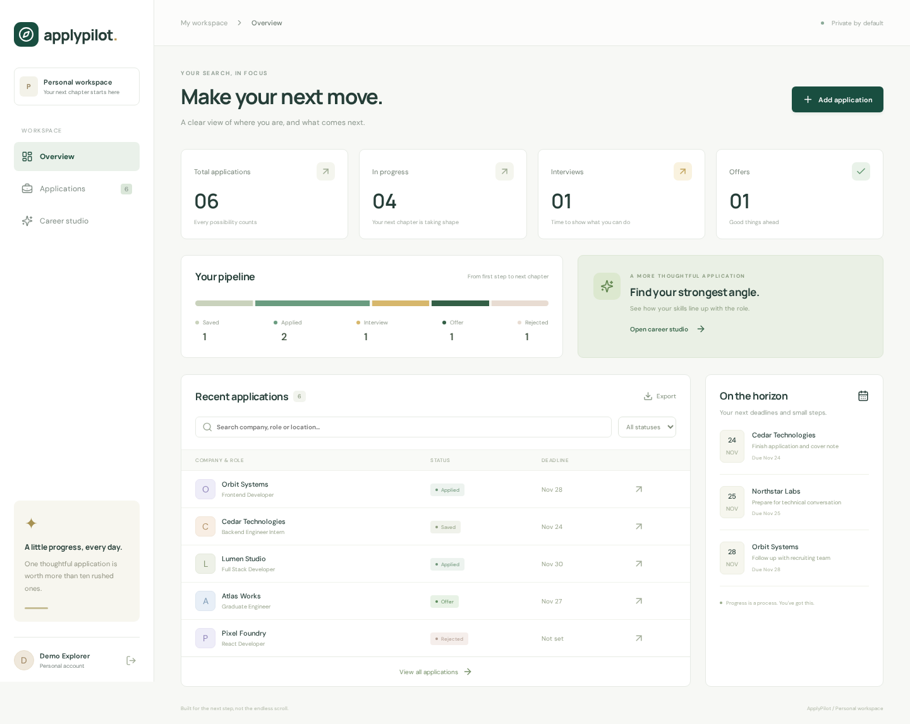
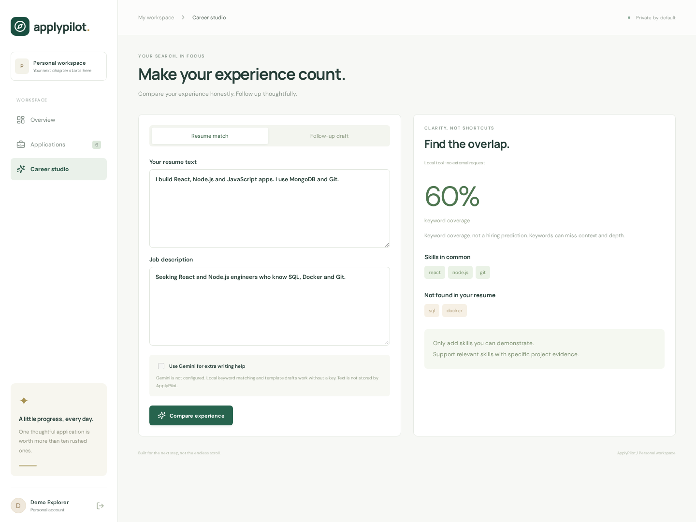
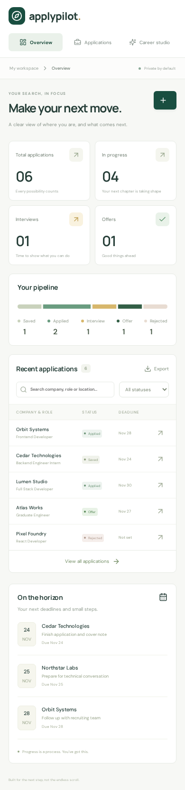

# ApplyPilot

**A personal workspace for the next chapter of your career.**

ApplyPilot is a MERN application for tracking job applications, keeping next actions visible, and preparing honest, reviewable application material. It pairs a working application tracker with an optional Gemini writing assistant. It does not apply to jobs or send email.



## Features

- Account registration and sign-in with bcrypt password hashes and HTTP-only session cookies.
- Create, edit and delete applications with a company, role, location, posting link, dates, next action and notes.
- Saved, Applied, Interview, Offer and Rejected stages with an append-only status-change history.
- Dashboard counts, pipeline distribution, and active-application deadlines, including overdue labels.
- Search by company, role or location; filter by stage; export your records as JSON.
- **Local resume matching:** a transparent, deterministic skill-keyword coverage score, matched skills and missing keywords. This is not an ATS score or hiring prediction.
- **Local follow-up drafts:** editable templates. No API key, network request to an AI provider or email integration is needed.
- **Optional Gemini assistance:** server-side API calls for resume advice and personalized follow-up drafts, only after the user checks the data-sharing option for that request.
- Responsive desktop and mobile layouts, keyboard-close dialogs, focus containment and locally bundled fonts.

## Screenshots

All applications and companies shown below are fictional. Screenshots come from the running app, not a design mockup.

| Dashboard                                    | Career studio                                        |
| -------------------------------------------- | ---------------------------------------------------- |
|  |  |

<details><summary>Mobile view</summary>



</details>

## Stack

| Layer          | Tools                                                              |
| -------------- | ------------------------------------------------------------------ |
| UI             | React 19, Vite, plain CSS, Lucide icons, DM Sans and Manrope       |
| API            | Node.js 22+, Express 5, Zod                                        |
| Data           | MongoDB and Mongoose                                               |
| Authentication | bcryptjs, signed JWT in an HTTP-only SameSite=Strict cookie        |
| AI             | Gemini REST generateContent API; default model: `gemini-2.5-flash` |
| Tests          | Node test runner, Supertest, Playwright, mongodb-memory-server     |

## Run a temporary demo

Prerequisites: Node.js 22+ and npm. The first demo/test run downloads a MongoDB binary, so internet access and a supported OS are required. The demo uses a **real ephemeral MongoDB process**, not localStorage or a mocked API.

```sh
npm ci
npm run demo
```

Open **http://127.0.0.1:5173**. The demo origin is intentionally `127.0.0.1`, not `localhost`, to match the origin check.

- Demo email: `demo@example.com`
- Demo password: `demo-password-2026`
- All records are fictional. Changes disappear when the demo server stops.
- The demo binds its API to loopback, uses a random per-run signing secret and has no Gemini key. Do not expose it to the internet.

## Run with persistent MongoDB

1. Start your own local MongoDB or prepare a MongoDB Atlas database.
2. Install dependencies and make a local environment file:

   ```sh
   npm ci
   cp .env.example .env
   ```

3. Set `MONGODB_URI`. Generate a random signing secret locally:

   ```sh
   node -e "console.log(require('node:crypto').randomBytes(48).toString('hex'))"
   ```

   Put the result in `JWT_SECRET` in `.env`. Never commit it.

4. Run `npm run dev`, open **http://localhost:5173**, and create your own account. Use `APP_ORIGIN=http://localhost:5173` as shown in `.env.example`.

The development Vite server proxies `/api` to Express. Persistent mode does not seed demo accounts or applications. MongoDB connection failures stop startup rather than silently switching to a different storage engine.

## Optional Gemini setup

Local matching and templates work without Gemini. To enable extra writing help:

1. Obtain your own Gemini API key from Google AI Studio. Keep it on the server in `GEMINI_API_KEY`; never use a `VITE_` variable for it.
2. Keep `GEMINI_MODEL=gemini-2.5-flash`, or choose another model supported by your key.
3. Restart the server. In Career studio, review the text, remove personal information and check **Use Gemini for extra writing help** for each request.

The submitted resume text, job description, company and role go to Google only when opted in. ApplyPilot does not store the pasted texts or AI output in MongoDB. Your browser keeps them in component state until you leave the page. The app never sends email.

Google lists a free tier for Gemini 2.5 Flash on its pricing page as checked on November 23, 2026. Availability, quotas and pricing may change. **This app cannot enforce your Google billing settings.** Use a free-tier project without paid billing if you want to avoid charges. Free-tier content may be used to improve Google products. Review Google's current terms before sending any personal or confidential data.

- [Google pricing and data-use information](https://ai.google.dev/gemini-api/docs/pricing?authuser=002)
- [Gemini generateContent API reference](https://ai.google.dev/api/generate-content?authuser=2)

The adapter has automated success, timeout and error-path tests with simulated provider responses. Live Gemini output has not been verified with a real key in this build. The app states the actual result source; it never presents a local template as generated AI.

## Commands

```sh
npm run demo       # ephemeral seeded MongoDB + API + UI
npm run dev        # persistent MongoDB + API + UI (needs .env)
npm test           # API and domain tests against ephemeral MongoDB
npm run build      # production UI bundle
npm run check      # lint + backend tests + production build
npx playwright install chromium
npm run test:e2e   # browser flows; automatically starts a fresh demo
npm run format     # format source files
```

## Production build

```sh
npm ci
npm run build
NODE_ENV=production APP_ORIGIN=https://your-domain.example npm start
```

Express serves `client/dist` and `/api` on the same origin. Set `MONGODB_URI`, `JWT_SECRET` and optional Gemini settings on the host. Use HTTPS because production cookies are Secure. `APP_ORIGIN` must exactly match the browser origin. Do not deploy the demo command.

Before a shared/public deployment, add account verification and recovery, infrastructure rate limits and HTTPS, operational monitoring, data deletion controls and backup policies. This is a portfolio project, not a production identity platform. The in-process rate limiter is not distributed; sessions expire after seven days but stolen tokens are not server-revoked on logout. Logout clears the browser cookie. See [architecture](docs/ARCHITECTURE.md) for design tradeoffs.

## Project layout

```text
client/src/App.jsx           workspace, dashboard and application list
client/src/components/       authentication, editing and career studio
client/src/lib.js            API helper and shared values
client/src/style.css         responsive styles and self-hosted font imports
server/src/app.js            Express routes, auth, validation and Gemini adapter
server/src/domain.js         schemas and local matching/drafting logic
server/src/models.js         owner-scoped Mongoose data models
server/src/index.js          persistent database startup
server/src/demo.js           loopback-only ephemeral demo
server/test/api.test.js      API and domain regression tests
tests/app.spec.js            desktop/mobile browser tests
docs/ARCHITECTURE.md         data flow, security and interview walkthrough
```

## API outline

All endpoints except health, registration, login and logout require the session cookie. Writes reject a mismatched browser Origin header; clients must send JSON.

| Method         | Path                    | Purpose                                        |
| -------------- | ----------------------- | ---------------------------------------------- |
| POST           | `/api/auth/register`    | Create account                                 |
| POST           | `/api/auth/login`       | Start session                                  |
| POST           | `/api/auth/logout`      | Clear session cookie                           |
| GET            | `/api/auth/me`          | Current user                                   |
| GET            | `/api/config`           | Gemini availability, never the key             |
| GET / POST     | `/api/applications`     | List owned records / create                    |
| PATCH / DELETE | `/api/applications/:id` | Update / delete an owned record                |
| POST           | `/api/assist`           | Local helper or explicit opt-in Gemini request |
| GET            | `/api/health`           | Database connectivity status                   |

## Limits and next steps

- Matching checks a small curated skill dictionary. It does not infer seniority, understand proficiency or judge whether a person is qualified.
- Deadlines are date-only values in the viewer's local day. They are visible reminders, not notifications or calendar events.
- Application lists are unpaginated, appropriate for a personal portfolio demo rather than a large multi-tenant product.
- No email sending, job-board scraping, resume-file parsing, account recovery, scheduled reminders or automatic submissions.
- Recommended next work: add route-level lazy loading, add pagination, add password recovery, and test with real Gemini access after reviewing its data policy.

## License

MIT. See [LICENSE](LICENSE). Third-party dependencies and fonts retain their own licenses.
